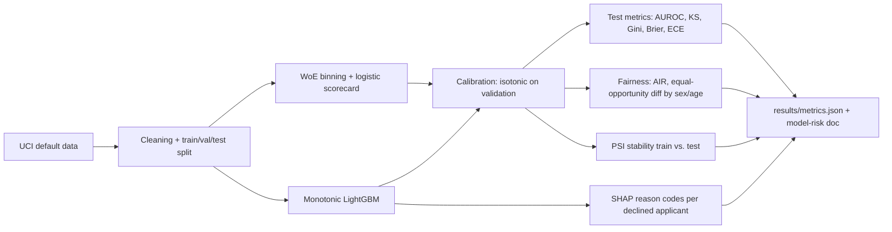

# Credit default risk: WoE scorecard vs monotonic LightGBM

This project builds a probability-of-default model on the UCI Default of Credit Card Clients data (30,000 Taiwanese card accounts from 2005). A weight-of-evidence logistic scorecard is the baseline. A monotonic LightGBM model is the challenger. Both are calibrated with isotonic regression fit on the validation set only. The held-out test set is scored once for AUROC, KS, Gini, Brier, and expected calibration error. Declined test applicants receive four adverse-action reason codes from TreeSHAP, and the same cutoff is used for adverse-impact and equal-opportunity checks by sex and age band.

## Setup

```text
python -m venv .venv
.venv\Scripts\pip install -r requirements.txt
```

## How to run

```text
python run.py
python run.py --quick
python run.py --device cpu
```

`python run.py` downloads the UCI workbook into `data/` if it is not already cached, rebuilds the stratified split, trains both models, and writes `results/`. `--quick` uses a 12% stratified subset and a smaller tree budget so the same path finishes in a few minutes. `--device cuda` is accepted and ignored: training stays on CPU.

## Architecture



## Design decisions

- The scorecard is the baseline because it is the standard interpretable PD model: train-only WoE bins, logistic regression on those WoE values, and a points scale with base 600 and 20 points to double the odds.
- LightGBM is constrained so higher delinquency or utilization cannot lower predicted default risk, and a higher limit or payment cannot raise it. Education, marriage, and raw bill amounts stay unconstrained because their direction is not reliable.
- The same model features, including utilization and payment aggregates, go into both models. The comparison is then about the algorithm, not a hidden feature advantage.
- Isotonic calibration, early stopping, the `C` grid, and the decline cutoff all use the validation set. The test set is not used to choose them.
- Reason codes are LightGBM TreeSHAP values on the default log-odds (`pred_contrib`). A code is emitted only when the value is on the adverse side of a training reference, so `HIGH` or `LOW` matches the monotonic constraint. A unit test checks that those contributions match `shap.TreeExplainer` on a small model.
- Sex and age are not model inputs. Fairness uses approval below the validation cutoff. The reference group is the largest group on that attribute.

## Limitations

- This is a personal portfolio study of a public 2005 dataset. It was not used in production and it is not a regulatory approval.
- There is no application date, so population stability is a random-split diagnostic rather than a through-the-time monitor.
- Monotone constraints can hide a real non-monotone pattern. Other features can still proxy for sex and age.
- Validation metrics are optimistic because early stopping and calibration see validation labels. Quote the test metrics.

## Dataset

Default of Credit Card Clients, UCI Machine Learning Repository, I-Cheng Yeh and Che-hui Lien. License: CC BY 4.0. The loader checks the file checksum and expects 30,000 rows and 6,636 defaults.

## Results

Numbers below are written by `python run.py` from `results/metrics.json`.

<!-- RESULTS_START -->
| Metric | Champion | WoE scorecard |
|---|---:|---:|
| AUROC | 0.7808 | 0.7612 |
| KS | 0.4234 | 0.3980 |
| Gini | 0.5615 | 0.5223 |
| Brier | 0.1353 | 0.1392 |
| ECE (10 bins) | 0.0123 | 0.0113 |

Champion: `monotonic_lightgbm`. Cutoff: 0.2432. Runtime: 2.6 s. Peak RSS: 0.232 GB.

| Success criterion | Value | Threshold | Passed |
|---|---:|---:|---|
| Test AUROC of the champion model | 0.7808 | >= 0.7700 | True |
| Champion vs. scorecard baseline | 0.0196 | >= 0.0100 | True |
| KS statistic of the champion | 0.4234 | >= 0.4000 | True |
| Expected calibration error (10 bins) after calibration | 0.0123 | <= 0.0300 | True |
| Reason codes | 1.0000 | >= 1.0000 | True |
| Fairness reporting | 1.0000 | >= 1.0000 | True |
| Test coverage of src/ | 89.4632 | >= 75.0000 | True |
<!-- RESULTS_END -->

Plots written next to the metrics file: `results/roc.png`, `results/calibration.png`, `results/score_distributions.png`.
