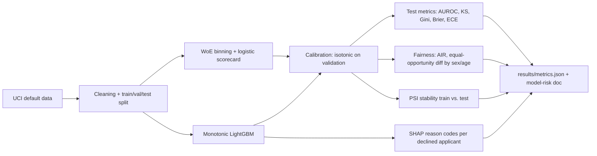

# Credit Default Risk Modeling - Logistic Scorecard vs. Monotonic Gradient Boosting, Calibration, Reason Codes, and Fair-Lending Checks

`credit-risk-scorecard` · new project · estimated build effort: 4 h

## Problem

Lenders need probability-of-default models that are accurate, calibrated, explainable to applicants, and checked for disparate impact before use. This project builds a traditional weight-of-evidence logistic scorecard and a monotonic-constrained LightGBM model on real credit-card default data, compares them on discrimination (AUROC, KS, Gini) and calibration on a held-out test set, generates the top adverse-action reason codes per declined applicant from SHAP values, measures adverse impact ratio and equal-opportunity difference across sex and age groups, checks population stability, and writes a short model-risk document with a champion/challenger recommendation.

## Target jobs and skills

- **Moody's — Associate Data Scientist** (`331a3dd5c5c7`): covers 71% of the JD's weighted top skills (Python, Machine Learning, Statistics, Regression, Classification, Data Visualization)
- **Citi — Senior Data Scientist Assistant Vice President** (`630cdf062c5e`): covers 64% of the JD's weighted top skills (Python, SQL, Statistics, Data Visualization, Classification, Machine Learning)
- **Zest AI — Data Scientist** (`72e542a48ca5`): covers 87% of the JD's weighted top skills (Python, SQL, Machine Learning, Classification, Model Evaluation, Gradient Boosting, Feature Engineering, Statistics)

Skills/tools this project demonstrates: Python, SQL, Machine Learning, Classification, Gradient Boosting, LightGBM, Regression, Statistics, Model Evaluation, Feature Engineering, Data Visualization, scikit-learn

## Data

- **Dataset:** Default of Credit Card Clients (Taiwan, 2005) — https://archive.ics.uci.edu/dataset/350/default+of+credit+card+clients
- **License/terms:** CC BY 4.0
- **Size used:** 30,000 clients, 23 features, ~5.5 MB xls (downloaded by script)
- **Plan:** Stratified 60/20/20 train/validation/test split with a fixed seed; binning, hyperparameters and the decision threshold are chosen on validation only; the test set is scored once. Sex and age band are used only for fairness evaluation, never as model inputs.

## Architecture

## Tech stack

Python 3.11, pandas, scikit-learn, LightGBM, shap, optbinning or hand-rolled WoE binning, matplotlib, pytest

## Deliverables

- WoE logistic scorecard with a points table (base 600, 20 points to double the odds)
- Monotonic-constrained LightGBM with isotonic calibration fit on validation only
- Reason-code generator returning the top 4 adverse-action reasons for each declined test applicant
- Fairness report: adverse impact ratio and equal-opportunity difference by sex and age band at the chosen cutoff
- PSI table for every model input (train vs. test), a model-risk write-up (MODEL_CARD.md), plots of ROC, calibration and score distributions

## Success criteria (all must hold on a from-scratch `python run.py`)

| Metric | Threshold | How it is measured |
|---|---|---|
| Test AUROC of the champion model | >= 0.77 | held-out test set, scored once |
| Champion vs. scorecard baseline | champion AUROC >= scorecard AUROC + 0.01 | same test set |
| KS statistic of the champion | >= 0.40 | test set |
| Expected calibration error (10 bins) after calibration | <= 0.03 | test set |
| Reason codes | every declined test applicant gets 4 reason codes, and each code's sign agrees with the monotonic constraint | pytest over all declined applicants |
| Fairness reporting | AIR and equal-opportunity difference reported for sex and 3 age bands; any AIR outside 0.80-1.25 is flagged in MODEL_CARD.md | fairness module + tests |
| Test coverage of src/ | >= 75% | pytest --cov |

## Evaluation artifacts (required; the evaluator recomputes metrics from these)

- results/test_predictions.csv with columns id, label (1 = default next month), champion_score (calibrated probability), scorecard_score (probability), sex, age_band - test set only
- results/split_ids.json with keys train, validation, test (lists of row ids)
- results/reason_codes.csv with columns id, reason_1, reason_2, reason_3, reason_4 for declined test applicants
- results/fairness.json with AIR and equal-opportunity difference per group at the cutoff stored as cutoff

## Baseline

Weight-of-evidence logistic regression scorecard (the industry-standard baseline).

## Constraints

- Runs on Windows with `python run.py` from a fresh virtualenv; no make, shell scripts, paid APIs, or accounts.
- CPU-only by default (an optional `--device cuda` flag is fine); peak RAM <= 3 GB; total downloads <= 1.5 GB.
- PyTorch (if used) pinned to the CPU wheel via `--extra-index-url https://download.pytorch.org/whl/cpu`.
- Fixed random seeds; every reported number is written by code to results/metrics.json (never typed by hand).
- Test split is created once, saved, and never used for training, tuning, or threshold selection.
- Data download is scripted (Python requests), cached under data/, and verified by checksum or row count.
- Real public data only; no claims of production use, real applicants, or regulatory approval.
- Protected attributes (sex, age) are excluded from model inputs and used only for fairness evaluation.

## Draft resume bullets (placeholders are filled only with reproduced metrics)

- Built a credit-default model on 30,000 real card accounts with monotonic LightGBM at [AUROC] AUROC and [KS] KS vs. [BASE_AUROC] for a WoE logistic scorecard, calibrated to [ECE] expected calibration error
- Generated top-4 adverse-action reason codes from SHAP for every declined applicant and checked adverse impact ratio across sex and age bands ([AIR_MIN] minimum)
- Documented stability (PSI) and a champion/challenger recommendation in a model-risk write-up
